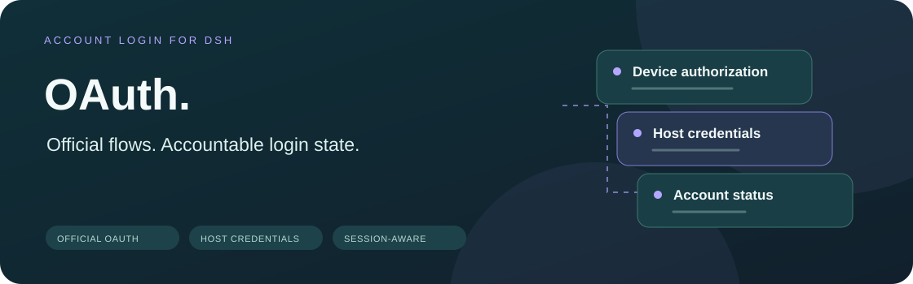
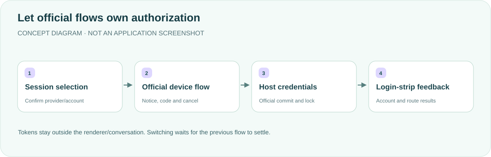

<div align="center">

<h1>OAuth · Account login strip</h1>
<p><strong>Manage Grok and GPT beside the composer, without copying authentication protocols.</strong></p>
<p>Official OAuth device login, account switching and logout for DeepSeek Harness desktop.</p>
<p><a href="README.md">简体中文</a> · <strong>English</strong></p>
<p><a href="package.json">v0.1.2</a> · <a href="LICENSE">MIT</a> · DSH desktop plugin</p>
<p><a href="#features">Features</a> · <a href="#how-it-works">How it works</a> · <a href="#quick-start">Quick start</a> · <a href="#accounts-and-configuration">Accounts and configuration</a> · <a href="#validation">Validation</a></p>
</div>

---

A reference for a personal DSH desktop workflow. Grok/GPT status appears below the composer; registered official flows perform authorization and tokens stay in the Host. Verify your DSH version and provider entitlement rather than copying personal settings unchanged.

## Features

<table><tr>
<td width="33%"><strong>🔑 Official device login</strong><br/><br/>Show the official notice URL/code and call authorization.begin, rather than reimplement polling or PKCE.</td>
<td width="33%"><strong>🔄 Switching and renewal</strong><br/><br/>Cancel and await settled authorization before switching; manual refresh uses the official credential lock.</td>
<td width="33%"><strong>🧭 Session-aware status</strong><br/><br/>Follow official model projections, clear stale account state and inspect history without resuming an Agent.</td>
</tr><tr>
<td><strong>🧩 Missing-route setup</strong><br/><br/>Inherit the official model catalog, retain existing configuration and use versioned concurrent writes.</td>
<td><strong>🛡 Host credentials</strong><br/><br/>No tokens in the Client or conversation and no access to other CLI auth.json files.</td>
<td><strong>🧾 Explicit outcomes</strong><br/><br/>Distinguish local logout from failed remote revocation, and saved credentials from failed route configuration.</td>
</tr></table>

## How it works



Calls official `authorization.begin({key, method: "oauth", interaction, signal})`. Registered `llm-pi-ai` flows own device codes, polling, PKCE, expiry and persistence. Official adapters handle normal renewal; the plugin stores no parallel credential copy.

## Quick start

Requires official DSH desktop and appropriate Grok/ChatGPT Codex account access. The original integration targets Grok/SuperGrok/X Premium and ChatGPT Plus/Pro Codex; actual provider acceptance determines availability.

```sh
export DSH_HOME="${DSH_HOME:-$HOME/.dsh}"
git clone https://github.com/yueyexiayu/dsh-OAuth.git "$DSH_HOME/plugins/OAuth"
```

Merge into `$DSH_HOME/profiles/desktop/cordis.patch.yml`, preserving other entries and the case-sensitive `OAuth` name:

```yaml
- insert:
    - id: OAuth
      name: ../../plugins/OAuth/lib/index.js
```

**Quit DSH fully with ⌘Q and reopen it.** Choose the provider button below the composer and follow its official device notice. Do not use CLI plugin management to alter the desktop profile; no official desktop rebuild is required.

## Accounts and configuration

| Item | Behavior |
| --- | --- |
| Storage | Host `$DSH_HOME/.credentials.yaml`: `llm-pi-ai/xai`, `llm-pi-ai/openai-codex` |
| Session selection | Official read-only `sessionQuery.observeSession`, `modelSelection.next ?? lastUsed` |
| Default model | Only an entry without sessionId or a confirmed existing empty session with no model selection |
| API Key routes | Explicitly state that OAuth logout does not change that authentication method |
| Route setup | Official `settings.describe/mutate`, preserving existing models/routes and rechecking version conflicts |

<details>
<summary><strong>Cancellation, races and failure semantics</strong></summary>

- Switching/logout first cancels the credential key's flow and awaits `authorization/settled`, then starts another flow or removes credentials. Unload, cancel and provider changes stop flows initiated here; arbitrary third-party flows ignoring cancellation cannot be guaranteed.
- Invalid sessionId returns 400; nonexistent sessions 404; changed/mismatched model or account 409. History, format, projection and persistence errors fail explicitly, without querying an unrelated global account.
- The Client subscribes to model projections; the Host rechecks ownership after async work. Late responses cannot replace new state, and background queries do not erase operation errors.
- Refresh requires valid access tokens. Missing expiry uses the official default; provided expiry must be finite/positive. Omitted refresh tokens retain the old value; present invalid ones fail without replacing credentials. A valid completed rotation survives later configuration failure or unload.
- Unsupported remote revocation is an explicit failure; local credentials are still removed and both outcomes are reported. Unsupported prompts and authorization/persistence errors are not reported as success.
- Known credentials are redacted from errors, not every unknown opaque token. The plugin never reads/writes `~/.grok/auth.json` or `~/.codex/auth.json`; no account credentials are included.

</details>

## Validation

```sh
cd "$DSH_HOME/plugins/OAuth"
for file in lib/*.js scripts/*.mjs test/*.mjs; do node --check "$file" || exit 1; done
node --test
```

Optional official-component verification:

```sh
DSH_OFFICIAL_NODE_MODULES=/absolute/path/to/official/node_modules node --test scripts/verify-official.mjs
```

Historical checks targeted official DSH 0.2.1-alpha.2 APIs. Fixtures use real official components, synthetic data and an in-memory credential queue, without networking or real account reads/writes. **This update checks documentation/layout only; product tests, actual login and desktop restart were not performed.** Component/mock-browser checks are not real-account end-to-end acceptance.

## License

[MIT License](LICENSE). Remove only this plugin's desktop entry and fully restart to uninstall; deleting a plugin is not proof of remote token revocation.

<div align="center"><sub>Official authorization. Factual status. · <a href="README.md">阅读中文版 →</a></sub></div>
