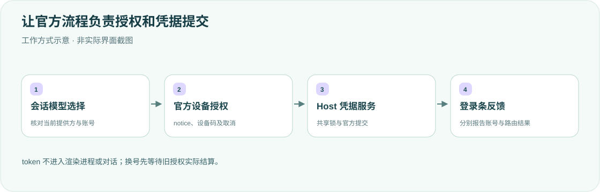

<div align="center">

<h1>OAuth · 账号登录条</h1>
<p><strong>在输入框旁管理 Grok 与 GPT 登录，不复制认证协议。</strong></p>
<p>DeepSeek Harness 桌面端的官方 OAuth 设备登录、换号与退出入口。</p>
<p><strong>简体中文</strong> · <a href="README.en.md">English</a></p>
<p><a href="package.json">v0.1.2</a> · <a href="LICENSE">MIT</a> · DSH desktop plugin</p>
<p><a href="#核心能力">核心能力</a> · <a href="#工作方式">工作方式</a> · <a href="#快速开始">快速开始</a> · <a href="#账号与配置">账号与配置</a> · <a href="#验证">验证</a></p>
</div>

---

针对个人 DSH 桌面工作流的参考实现。输入框下方显示 Grok / GPT 状态，授权由官方已注册的 flow 完成，token 只留在 Host。请先核对自己的 DSH 版本与提供方权限，不直接照搬个人配置。

## 核心能力

<table><tr>
<td width="33%"><strong>🔑 官方设备登录</strong><br/><br/>展示官方 notice 链接和设备码，调用 authorization.begin，不自行重写轮询或 PKCE。</td>
<td width="33%"><strong>🔄 换号与续期</strong><br/><br/>换号先取消旧授权并等待 settled；手动刷新在官方凭据锁内执行。</td>
<td width="33%"><strong>🧭 会话感知状态</strong><br/><br/>跟随官方模型投影，切换会话/模型清除旧账号，不为读历史恢复 Agent。</td>
</tr><tr>
<td><strong>🧩 补齐缺失路由</strong><br/><br/>沿用官方模型目录，保留已有列表和配置，用版本号处理并发修改。</td>
<td><strong>🛡 Host 内凭据</strong><br/><br/>不把 token 写入 Client 或对话，也不读取其他 CLI 的 auth.json。</td>
<td><strong>🧾 明确操作结果</strong><br/><br/>区分本地退出与远端吊销失败；凭据成功保存不冒充路由配置也成功。</td>
</tr></table>

## 工作方式



使用官方 `authorization.begin({key, method: "oauth", interaction, signal})`，由 `llm-pi-ai` flow 负责设备码、轮询、PKCE、期限及提交。正常续期由官方适配器负责；本插件不另存认证副本。

## 快速开始

需要官方 DSH 桌面版及对应 Grok / ChatGPT Codex 账号权限。原适配面向 Grok/SuperGrok/X Premium 与 ChatGPT Plus/Pro Codex；最终以官方接口实际接受的账号为准。

```sh
export DSH_HOME="${DSH_HOME:-$HOME/.dsh}"
git clone https://github.com/yueyexiayu/dsh-OAuth.git "$DSH_HOME/plugins/OAuth"
```

将下项合并到 `$DSH_HOME/profiles/desktop/cordis.patch.yml`，保留其他插件；`OAuth` 大小写一致：

```yaml
- insert:
    - id: OAuth
      name: ../../plugins/OAuth/lib/index.js
```

**⌘Q 完全退出 DSH 后重开**，在输入框下方选择对应登录按钮，按官方 notice 完成设备授权。不使用 CLI 插件管理改 desktop profile，不需要重建官方桌面包。

## 账号与配置

| 项目 | 行为 |
| --- | --- |
| 存储 | Host 的 `$DSH_HOME/.credentials.yaml`，键为 `llm-pi-ai/xai`、`llm-pi-ai/openai-codex` |
| 会话选择 | 官方只读 `sessionQuery.observeSession`，`modelSelection.next ?? lastUsed` |
| 默认模型 | 仅无sessionId新入口，或已确认存在但无模型选择的空会话采用 |
| API Key 路由 | 明示退出 OAuth 不改变该认证，不擅自切换方式 |
| 路由补全 | 官方 `settings.describe/mutate`，保留已有路由/模型，版本冲突重查 |

<details>
<summary><strong>取消、竞态与失败语义</strong></summary>

- 换号/退出先取消同凭据key的授权并等待官方 `authorization/settled`，再启动新授权或删除凭据。卸载、取消和会话切换到其他提供方中止本插件发起的flow；不保证任意忽略取消的第三方实现。
- 无效sessionId返回400，不存在404，模型/账号不匹配或已切换409。历史读取、格式、投影及持久化异常明确失败，不回落无关全球账号。
- Client 订阅模型投影，Host 异步完成后再次核对归属，旧请求不覆盖新状态。后台查询不清除操作错误。
- 刷新需合法 access token；缺少有效期采用官方默认，给出时须有限正数。省略 refresh token 保留旧值；字段存在但无效时拒绝并保留旧凭据。已完成轮换的有效凭据不会因后续配置失败或卸载丢弃。
- 远端不支持吊销时明确报失败；本地凭据仍删除，分别显示结果。不支持的交互prompt与授权/提交失败直接显示，不假装成功。
- 已知凭据在错误中脱敏，不声称识别任意未知opaque token。不读取或改写 `~/.grok/auth.json` / `~/.codex/auth.json`，仓库不含账号凭据。

</details>

## 验证

```sh
cd "$DSH_HOME/plugins/OAuth"
for file in lib/*.js scripts/*.mjs test/*.mjs; do node --check "$file" || exit 1; done
node --test
```

可选官方组件验证：

```sh
DSH_OFFICIAL_NODE_MODULES=/absolute/path/to/official/node_modules node --test scripts/verify-official.mjs
```

旧记录核对过 DSH0.2.1-alpha.2 的官方接口，fixture使用真实官方组件、合成数据和内存凭据队列，不联网、不读写真实账号。**本次仅检查文档和排版，未重跑产品测试、实际登录或重启桌面。** 模拟浏览器/组件检查不等于真实账号端到端验收。

## 许可

[MIT License](LICENSE)。卸载只移除本插件的desktop加载项后完整重启；不要把删除插件当成已完成远端吊销。

<div align="center"><sub>授权交给官方，状态显示事实。 · <a href="README.en.md">Read in English →</a></sub></div>
